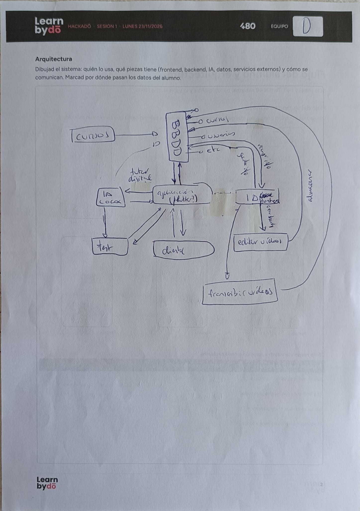

## 1. El alumno y su problema
  La solución propuesta, principalmente, es para los alumnos de 480 Academy que hacen los cursos online.
  Hoy en día muchos se saltan los vídeos, ya sea por aburrimiento, tendencias (están acostumbrados a contenido corto), contenido poco dinámico...

## 2. Flujo del alumno

  

  1. **Login:** el alumno entra con su usuario y contraseña, o se registra si es la primera vez.
  2. **Home:** ve los cursos nuevos, los que son tendencia y los que se están promocionando, pudiendo elegir uno para iniciar.
  3. **Mis cursos:** aparecen los cursos que está haciendo, con el temario dividido en lecciones (1.1, 1.2...) para ver por dónde va.
  4. **Vídeos / Módulo:** ve el vídeo de la lección y, al terminar, puede hacer el test de ese módulo.
  5. **Shorts / Módulo:** la misma lección en vídeos cortos que se van pasando deslizando, como en YouTube Shorts o TikTok.
  6. **Repaso / Tutor:** chat con el tutor digital para resolver dudas y repasar lo que ha fallado en los tests.

  La barra de abajo tiene cuatro accesos: inicio, repaso, cursos y perfil.

## 3. Respuesta a los problemas
  - Los alumnos se saltan vídeos: Opción de contenido corto y resumido.
  - Los itinerarios son iguales para todos: Test inicial en el módulo para valorar el conocimiento y así poder saltar a la parte que no conoce.
  - No sabemos si el alumno aprende: Tests gamificados (por cada lección), obligando al usuario a volver a ver las partes del vídeo en las que ha fallado.
  - El acompañamiento no llega a todos: Tutor digital, mediante un chatbot.

## 4. Historias de usuario
  | Como... | Quiero... | Para... | Prioridad (imprescindible / deseable / fuera) | Criterios de aceptación
  | --- | --- | --- | --- | --- |
  | Usuario | Acceder un curso de la manera más eficiente | tener un aprendizaje que sea amable con mi tiempo | deseable | Que desde la home pueda entrar a un curso y seguir por donde lo dejé en pocos pasos
  | Usuario | Una interfaz accesible e intuitiva | Facilitarme el uso de la aplicación | imprescindible | Que se pueda llegar a todas las pantallas desde la barra de abajo
  | Usuario | Privacidad en mis datos | Que ninguna IA se aproveche de ellos | imprescindible | Que sea transparente todo el flujo de mis datos
  | Usuario | Ver el contenido en vídeos cortos | Aprender sin tener que ver el vídeo entero | imprescindible | Que cada lección tenga sus shorts y se puedan pasar deslizando
  | Usuario | Hacer un test al acabar cada lección | Saber si he entendido el contenido | imprescindible | Que si fallo una pregunta me lleve a la parte del vídeo donde se explica
  | Usuario | Hacer un test al empezar un módulo | Saltarme lo que ya sé | deseable | Que según el resultado se salten las lecciones que ya domino
  | Usuario | Un tutor digital al que preguntarle dudas | Resolverlas sin tener que esperar a un tutor | fuera | Que responda solo sobre el temario del curso y la plataforma

## 5. Arquitectura

  

  - **Cliente:** el alumno, que usa la app desde el móvil.
  - **Aplicación:** la app móvil. Es la pieza central: muestra los cursos, los vídeos, los shorts y los tests, y se comunica con la BBDD y con las IAs.
  - **BBDD:** guarda los cursos, los usuarios, el progreso, los shorts y las transcripciones. La app y las IAs leen y escriben aquí.
  - **Cursos:** el contenido original de 480 Academy (vídeos y textos), que se carga en la BBDD.
  - **IA local (tutor digital):** el chatbot que resuelve dudas del alumno. Consulta los cursos en la BBDD para responder. Es local para cubrir con la protección de datos.
  - **Test:** los tests de cada módulo, que genera la IA local a partir de las transcripciones, para intentar evitar plagios. El alumno resuelve estos desde la app.
  - **IA frontera:** coge la información de los cursos de la BBDD, organiza el trabajo de transcribir y editar los vídeos y vuelve a subir el resultado.
  - **Transcribir vídeos:** pasa el audio de los vídeos a texto y lo guarda en la BBDD.
  - **Editor de vídeos:** corta los vídeos largos en shorts y los guarda en la BBDD.

  La IA frontera, la transcripción y el editor de vídeos son un paso previo y externo a la app: se usan una sola vez para preparar el catálogo y la app nunca procesa vídeos.

  Los datos del alumno solo pasan por la app, la BBDD y la IA local. La IA frontera solo trabaja con el contenido de los cursos, nunca con datos de alumnos.

  Este es el diseño final. Para la demo del 30/11 la IA local queda fuera porque se sale del alcance de una demo (apartado 11).

## 6. Modelo de datos y flujo hacia la IA
  Utilizaremos la IA para un chatbot, edición+transcripción de video, generación de vídeos cortos y generación de tests dinámicos. Los datos que saldrían serían los que el usuario exponga en el chatbot. Para que haya privacidad en la información, utilizamos una IA local para que el tratamiento de datos dependa exclusivamente de la empresa y no de externas (explicar en un apartado de la app o en el chatbot la trazabilidad de sus datos)

  **Entidades principales:**
  - **Alumno:** id, nombre, email y los cursos que hace.
  - **Curso:** título, descripción y si es nuevo, tendencia o promocionado.
  - **Módulo / Lección:** parte de un curso, con su orden (1.1, 1.2...).
  - **Vídeo:** el vídeo de la lección, con su transcripción y dividido por temas.
  - **Short:** trozo corto de un vídeo.
  - **Test:** preguntas de cada lección, cada una enlazada a la parte del vídeo donde se explica.
  - **Progreso:** qué ha visto el alumno y qué ha acertado o fallado en los tests.
  - **Conversación:** los mensajes del alumno con el tutor.

  **Datos del alumno que van a la IA:**
  - Tutor digital: lo que escribe en el chat y su progreso, para saber qué tiene que repasar.
  - Generación de tests, transcripción y shorts: ningún dato del alumno, solo el contenido de los cursos.

  Como hay alumnos menores de 18 años y estamos sujetos al RGPD, a la IA nunca le llega el nombre ni el email del alumno, solo un id. Además, al ser una IA local, los datos no salen de la empresa.

## 7. Agentes de IA

  | Agente | Qué hace | Modelo y por qué | Entrada | Salida | Límites
  | --- | --- | --- | --- | --- | --- |
  | Chatbot | Es el encargado de manejar el chatbot | Qwen3 8B, ya que consume muy pocos recursos y es suficiente para hacer un chatbot | Texto | Texto | Límite de solicitudes/tokens y límites de respuesta, para que no se salga del contexto |
  | Editor de video | Coge vídeos ya creados y crea shorts a partir de ellos, y además particiona los vídeos | Modelo frontera + MCP editor | Vídeos | Vídeos | No añadir contenido inventado |
  | Generación de test | Coge la trascripción del vídeo y genera tests a partir de las transcripciones | Qwen3 8B, ya que no se necesita ningún modelo grande para hacer esto | Texto | Texto | Contenido que no se salga de lo impartido |
  | Trascripción | Convertir audio a texto | WhisperX, porque es el mejor modelo de transcripción | Vídeo | Texto | No generar texto que no esté en el vídeo |

## 8. Contenido

  Para hacer la demostración hemos escogido un curso de JAVA genérico de Youtube. Hemos elegido los siguientes vídeos:
  - https://www.youtube.com/watch?v=NFDjCN4r_68&list=PLG1qdjD__qH6ULjW5iN8E45m5nkaCNbUu
  - https://www.youtube.com/watch?v=dfEEG4A_Hoo&list=PLG1qdjD__qH6ULjW5iN8E45m5nkaCNbUu&index=2
  - https://www.youtube.com/watch?v=b003s0CJ2KU&list=PLG1qdjD__qH6ULjW5iN8E45m5nkaCNbUu&index=3
  - https://www.youtube.com/watch?v=pgF8U9WxPts&list=PLG1qdjD__qH6ULjW5iN8E45m5nkaCNbUu&index=4
  - https://www.youtube.com/watch?v=98m39gc3YpM&list=PLG1qdjD__qH6ULjW5iN8E45m5nkaCNbUu&index=5
  - https://www.youtube.com/watch?v=GwwRkMo012Y&list=PLG1qdjD__qH6ULjW5iN8E45m5nkaCNbUu&index=6
  - https://www.youtube.com/watch?v=taSJeALBVGk&list=PLG1qdjD__qH6ULjW5iN8E45m5nkaCNbUu&index=7
  - https://www.youtube.com/watch?v=tldDbZ9MSoA&list=PLG1qdjD__qH6ULjW5iN8E45m5nkaCNbUu&index=8
  - https://www.youtube.com/watch?v=gWYWRs9d_ZI&list=PLG1qdjD__qH6ULjW5iN8E45m5nkaCNbUu&index=9
  - https://www.youtube.com/watch?v=P73Sa4dzvoc&list=PLG1qdjD__qH6ULjW5iN8E45m5nkaCNbUu&index=10
  - https://www.youtube.com/watch?v=bRwz1J9hxEg&list=PLG1qdjD__qH6ULjW5iN8E45m5nkaCNbUu&index=11
  - https://www.youtube.com/watch?v=ijz6rAu5Trw&list=PLG1qdjD__qH6ULjW5iN8E45m5nkaCNbUu&index=12
  - https://www.youtube.com/watch?v=3FIomL6wFFM&list=PLG1qdjD__qH6ULjW5iN8E45m5nkaCNbUu&index=13
  - https://www.youtube.com/watch?v=rH60985e4PM&list=PLG1qdjD__qH6ULjW5iN8E45m5nkaCNbUu&index=14
  - https://www.youtube.com/watch?v=V-WDyYJqPnY&list=PLG1qdjD__qH6ULjW5iN8E45m5nkaCNbUu&index=15
  - https://www.youtube.com/watch?v=ZzFF_aXLO5g&list=PLG1qdjD__qH6ULjW5iN8E45m5nkaCNbUu&index=16
  - https://www.youtube.com/watch?v=8gkaitxt-CI&list=PLG1qdjD__qH6ULjW5iN8E45m5nkaCNbUu&index=17
  - https://www.youtube.com/watch?v=Q_2j8aYnmYk&list=PLG1qdjD__qH6ULjW5iN8E45m5nkaCNbUu&index=18
  - https://www.youtube.com/watch?v=AVEU8AEZ5YE&list=PLG1qdjD__qH6ULjW5iN8E45m5nkaCNbUu&index=19
  - https://www.youtube.com/watch?v=QRDePHN91UY&list=PLG1qdjD__qH6ULjW5iN8E45m5nkaCNbUu&index=20

  Las transcripciones saldrán de la IA WhisperX.

## 9. Coste

  ### Hipótesis
  - Volumen: 1.200 alumnos activos y 400 vídeos de 15 min de media (100 horas totales; el 30% ya tiene transcripción).
  - Uso mensual por alumno: 20 mensajes al tutor digital y 4 tests dinámicos al mes.
  - Infraestructura: Procesado previo del catálogo con IA frontera (una sola vez) y ejecución en producción de Qwen3 8B y WhisperX en un servidor GPU propio (24 GB VRAM) para cumplir el RGPD sin enviar datos de menores a terceros.

  ### Estimación de costes
  - Coste único: <5€ para transcripciones y sectorizar/cortar shorts
  - Coste recurrente mensual: ~180 € / mes por el alquiler del servidor GPU dedicado
  - Coste por alumno y mes: 0,15 € / alumno / mes

  ### Cómo lo reduciríamos
  - Banco de preguntas pre-generado: Generar 15-20 preguntas por vídeo una sola vez y servir 5 aleatorias por alumno.
  - Auto-escalado horario: Apagar o reducir la instancia GPU de madrugada.
  - Límite de contexto: Pasar a Qwen3 8B solo el fragmento de transcripción de la lección actual y los últimos 4 mensajes del chat.

## 10. Idea original

  - Introducción de shorts: Mejora el aprendizaje del alumno haciéndolo de manera mas interactiva.
  - Introducción de test: pruebas de conocimiento tanto para aprender como dinamizar lo que el alumno debe estudiar, lo que ayuda a reiterar contenidos o saltarlos.
  - Sectorización de vídeos con descripción: índices especiales en los vídeos para saltarlos según tema y para saber qué debe de ver un estudiante si falla una pregunta del test.
  - Tutor digital: chat para resolver dudas del temario que pida el estudiante o respecto todo lo que envuelve el producto (480 Academy).

## 11. Alcance para el 30/11

  Estaría fuera de nuestro alcance el uso de IA local, ya que sería inviable por el tema hardware.
  Entra todo el flujo de la interacción con un curso.
  Para la demo, los shorts y las transcripciones de los vídeos del curso ya estarán preparados de antes, así que no construimos el editor de vídeos.

  
