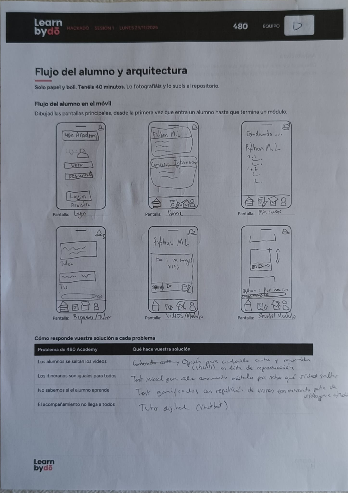

## 1. El alumno y su problema
  La solución propuesta, principalmente, es para los alumnos que se saltan los videos, ya sea por aburrimiento, tendencias, contenido poco dinámico...

## 2. Flujo del alumno

  

  1. **Login:** el alumno entra con su usuario y contraseña, o se registra si es la primera vez.
  2. **Home:** ve los cursos nuevos, los que son tendencia y los que se están promocionando, y elige uno.
  3. **Mis cursos:** aparecen los cursos que está haciendo, con el temario dividido en lecciones (1.1, 1.2...) para ver por dónde va.
  4. **Vídeos / Módulo:** ve el vídeo de la lección y, al terminar, puede hacer el test de ese módulo.
  5. **Shorts / Módulo:** la misma lección en vídeos cortos que se van pasando deslizando, como en YouTube Shorts o TikTok.
  6. **Repaso / Tutor:** chat con el tutor digital para resolver dudas y repasar lo que ha fallado en los tests.

  La barra de abajo tiene cuatro accesos: inicio, tests/repaso, cursos y perfil.

## 3. Respuesta a los problemas
  - Los alumnos se saltan vídeos: Opción de contenido corto y resumido.
  - Los itinerarios son iguales para todos: Test inicial para valorar el conocimiento y así poder saltar a la parte del curso que no conoce.
  - No sabemos si el alumno aprende: Tests gamificados (por cada lección), obligando al usuario a volver a ver las partes del vídeo en las que ha fallado.
  - El acompañamiento no llega a todos: Tutor digital, mediante un chatbot.

## 4. Historias de usuario
  | Como... | Quiero... | Para... | Prioridad (imprecindible / deseable / fuera) | Criterios de aceptación
  | --- | --- | --- | --- | --- |
  | Usuario | Acceder un curso de la manera más eficiente | tener un aprendizaje que sea amable con mi tiempo | deseable | 
  | Usuario | Una intefaz accesible e intuitiva | Facilitarme el uso de la aplicación | imprescindible | 
  | Usuario | Privacidad en mis datos | Que ninguna IA se aproveche de ellos | imprescindible | Que sea trasparente todo el flujo de mis datos
  | Usuario |

## 5. Arquitectura

  

  - **Cliente:** el alumno, que usa la app desde el móvil.
  - **Aplicación:** la app móvil. Es la pieza central: muestra los cursos, los vídeos, los shorts y los tests, y se comunica con la BBDD y con las IAs.
  - **BBDD:** guarda los cursos, los usuarios, el progreso, los shorts y las transcripciones. La app y las IAs leen y escriben aquí.
  - **Cursos:** el contenido original de 480 Academy (vídeos y textos), que se carga en la BBDD.
  - **IA local (tutor digital):** el chatbot que resuelve dudas del alumno. Consulta los cursos en la BBDD para responder. Es local para que los datos del alumno no salgan fuera.
  - **Test:** los tests de cada módulo, que genera la IA local a partir de las transcripciones. El alumno los hace desde la app.
  - **IA frontera:** coge la información de los cursos de la BBDD, organiza el trabajo de transcribir y editar los vídeos y vuelve a subir el resultado.
  - **Transcribir vídeos:** pasa el audio de los vídeos a texto y lo guarda en la BBDD.
  - **Editor de vídeos:** corta los vídeos largos en shorts y los guarda en la BBDD.

  Los datos del alumno solo pasan por la app, la BBDD y la IA local. La IA frontera solo trabaja con el contenido de los cursos, nunca con datos de alumnos.

  Este es el diseño final. Para la demo del 30/11 la IA local queda fuera porque se sale del alcance de una demo (ver apartado 11).

## 6. Modelo de datos y flujo hacia la IA
  Utilizaremos la IA para un chatbot, edición de video y generación de tests dinámicos. Los datos que saldrían serían los que el usuario exponga en el chatbot. Para que haya privacidad en la información, utilizaríamos una IA local para que no salieran los datos a luz.

## 7. Agentes de IA

  | Agente | Qué hace | Modelo y por qué | Entrada | Salida | Límites
  | --- | --- | --- | --- | --- | --- |
  | Chatbot | Es el encargado de manejar el chatbot | Qwen3 8B, ya que consume muy pocos recursos y es suficiente para hacer un chatbot | Texto | Texto | Límite de solicitudes/tokens y límites de respuesta, para que no se salga del contexto |
  | Editor de video | Coge vídeos ya creados y crea shorts a partir de ellos, y además particiona los vídeos | Modelo frontera + MCP editor | Vídeos | Vídeos | No añadir contenido inventado |
  | Generación de test | Coge la trascripción del vídeo y genera tests a partir de las transcripciones | Qwen3 8B, ya que no se necesita ningún modelo grande para hacer esto | Texto | Texto | Contenido que no se salga de lo impartido |
  | Trascripción | Convertir audio a texto | WhisperX, porque es el mejor modelo de transcripción | Vídeo | Texto | No generar texto que no esté en el vídeo |

## 8. Contenido

## 9. Coste

## 10. Idea original

  - Introducción de shorts: Mejora el aprendizaje del alumno haciéndolo de manera mas interactiva.

## 11. Alcance para el 30/11

  Estaría fuera de nuestro alcance el uso de IA local, ya sería inviable por el tema hardware, la implementación del chatbot ya que no disponemos de IA local.
  Entra todo el flujo de la interacción con un curso.

  
